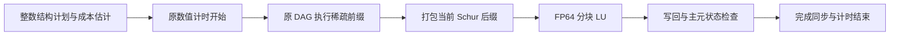

# c120：机制、成绩与运行

当前仓库新增 c140，使用新 G2 的五套评测结果及两版本比较命令见 [c140 说明](c140.md)。下文 c120 历史结果继续保留原来的旧 G2 / GPU0 口径。

**数据版本说明：** 当前仓库的 G2 矩阵已替换为 150102 阶、726674 非零元的新版本，参考解与清单同步更新。下文历史成绩和 `c120-results.json` 使用旧的 438388 非零元 G2，不能作为当前数据集的成绩。此次只同步数据，没有重新评测或修改 c120 算法。

`versions/c120/` 是冻结候选 `numeric-c120` 的源码发布副本，沿用本仓库各版本的目录布局。所包含源码逐文件与冻结版本一致；未修改算法、FP64 类型或阶段计时实现。Python 绑定源码也保留，但本包的运行比较入口是 `src/lu_cmd`。

## 相对 GLU 的成绩

在原 Mars GPU0（native warp 64、104 SM）、HPCC 3.5.3.18 / cu-bridge、ARM64 环境中，冻结代码完成五套全 12 矩阵评测。每套的 GLU 与 c120 均重新运行，每矩阵每版本 1 次预热、7 次正式计时。

五套数值分解几何平均加速比依次为 **10.239499、10.891482、10.919575、10.216093、10.728092 倍**；跨五套几何平均为 **10.594385 倍**。对数尺度 t 方法的 95% 区间为 `[10.170822, 11.035587]`。

| 矩阵 | GLU 数值分解 ms | c120 数值分解 ms | 几何加速比 |
| --- | ---: | ---: | ---: |
| ASIC_100k_csr | 663.294205 | 49.340106 | 13.442802 |
| ASIC_100ks_csr | 169.067295 | 45.933949 | 3.678826 |
| ASIC_680ks_csr | 156.758531 | 38.514909 | 4.067632 |
| G2_circuit_csr | 58.877868 | 5.531859 | 10.640965 |
| add32_csr | 14.260852 | 0.456822 | 31.227091 |
| bcircuit_csr | 39.612722 | 3.669503 | 10.773260 |
| dianwangmatrix1_csr | 49.805872 | 3.343646 | 14.855379 |
| dianwangmatrix2_csr | 295.146514 | 96.887017 | 3.041000 |
| rajat13_csr | 16.089583 | 0.478412 | 33.613139 |
| rajat26_csr | 27.399628 | 1.476083 | 18.555463 |
| rajat27_csr | 22.519799 | 1.059364 | 21.240417 |
| twotone_csr | 566.602712 | 122.074179 | 4.639427 |

耗时列是五套共 35 次正式值的算术均值。加速比列是五套各矩阵“GLU 七次均值 / c120 七次均值”的几何平均，因此不等于表中两个耗时列直接相除。整套指标对 12 个矩阵等权取几何平均，不乘 0.005，不将矩阵时间相加。

[c120-results.json](c120-results.json) 保存五套全部 840 个正式数值分解时间值、每套逐矩阵统计、汇总、运行标识和原结果文件摘要。所有正式样本均保留，包括慢样本。原完整评测通过求解正确性及阶段计时审计，累计独立重载 1440 份求解向量及 1440 份阶段报告。

这些是同一公开 12 例上的重复测试，没有独立验证集或封闭测试集。本仓库的 `compare.py` 是便携比较工具，其检查范围见根目录 README；这里的历史成绩来自原完整评测器。本次发布检查了源码一致性和包内校验，没有新增 GPU 性能评测，也没有完成 NVIDIA 编译验证。

## 数值分解方法

保留原 FP64、unit-L、排序和主元处理，以及 right-looking LU 的 level DAG。已有目标归并更新、短组串行和长组 native-warp 归约、结构缓存及原稠密块路径继续使用。

新增路径将自然列后缀作为稠密 Schur 块：后缀源只更新更后的列，因此可先按原 DAG 执行全部稀疏前缀源，再执行后缀。前缀对后缀的更新全部保留；选中后缀源在原 kernel 中通过 cut 屏蔽，最后仅在稠密路径执行一次。



CPU 使用符号结构和任务工作量，在最后 512～4096 列内选择切分点。成本模型分别估计稀疏更新、稠密 trailing update、面板、打包与图调度成本。常数来自原 GPU 诊断并编译入代码，运行时不读取参考解、评测分数或矩阵名称。原 95% 密度方案作为回退；模型选择需超过保守利润门槛。

原测试中，新路径分别为 ASIC_100k 选择 1311 列后缀（符号密度约 75.04%），为 dianwangmatrix2 选择 570 列（95.02% 回退），为 twotone 选择 3274 列（65.40%）。ASIC_100ks 和 ASIC_680ks 沿用原稠密块。

稠密路径每个 panel 为 16 列，16×16 对角块 A11 驻留共享内存，下方面板 L21 由线程用 FP64 寄存器并行求解，U12 和 trailing update 沿用原实现。A11/L21 拆分已在历史 c97 尝试；c120 继承后续共享对角块实现及新的结构成本分界。长组并行归约改变浮点累加顺序，原完整正确性检查全部通过。

所有数值打包、分解、写回和完成同步都处于原 `numeric_factorization` 区间内。符号准备只生成结构和索引，不提前计算数值答案。混合层保留具备 cut 屏蔽的普通图调度，未屏蔽的 narrow chain 排除选中后缀源。

成本常数在原平台校准，其他 GPU 上需要实际比较。移植或调参应另建版本，保留本候选作对照。

## 编译与比较

在仓库根目录，例如 NVIDIA A100：

```bash
bash build.sh sm_80 glu-original c120
CUDA_VISIBLE_DEVICES=0 python3 compare.py --versions glu-original c120 --matrices add32_csr --repeats 1
CUDA_VISIBLE_DEVICES=0 python3 compare.py --versions glu-original c120
```

将 `sm_80` 换成目标架构；支持时可使用 `native`。这些是仓库已有 CUDA 构建入口的扩展，尚未在 NVIDIA 上验证 c120 编译及执行。

单独运行时使用独立输出目录，避免覆盖 `x.dat` 和 `timings.json`：

```bash
repo_root=$(pwd)
run_dir=$(mktemp -d)
cd "$run_dir"
"$repo_root/versions/c120/src/lu_cmd" -i "$repo_root/matrices/add32_csr.mtx"
```

原测评环境使用外部 `make_hpcc` 包装器和固定工具链。其构建顺序为清理主程序、重新编译 `nicslu/lib`、重新编译 `nicslu/util`、`make_hpcc MAIN`。该包装器由原 HPCC 环境提供，不属于本源码包；根目录 `build.sh` 使用 NVIDIA `nvcc`。两种环境的性能不可直接混用。

原冻结二进制 SHA-256 为 `f00526959a5217643f9374f1dd2af2a844f9eff4404af14c4d5c083ac3d547da`。完整冻结候选的源摘要为 `sha256:3e273529e7f749649bb3e0bb652f4533d17c70b941283ad592880dd14d691928`；本仓库只发布按既有布局选取的源码与依赖，因此用 `SOURCE_MANIFEST.json` 逐文件核对，不将发布子集称为完整源摘要相同。Git 不包含原 ARM64 编译产物，本机发布目录另保留一份被 Git 忽略的冻结 `src/lu_cmd`。

许可证保留于 [LICENSE.txt](../versions/c120/LICENSE.txt)、NICSLU 的 `lesser.txt` 以及 `include/ryu/` 内。原 GLU、c94、c104、c106 及 c120 源码保持原样；仅 G2 矩阵与参考解替换为新版本，其他矩阵与参考解保持原样。
