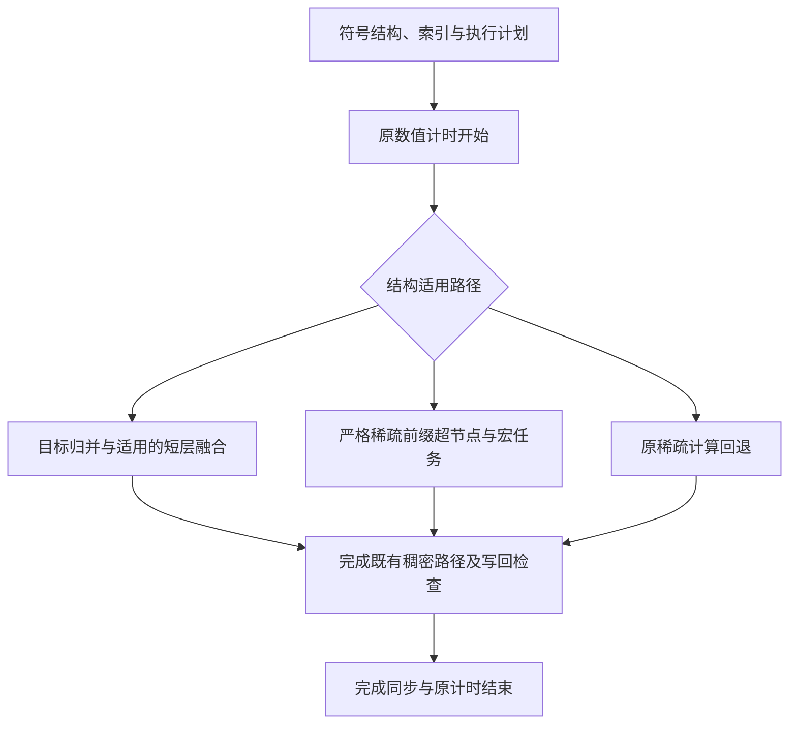

# c140：稀疏数值分解、成绩与运行

`versions/c140/` 是冻结候选 `numeric-c140` 的源码发布副本。89 个源码、头文件和许可证逐文件与冻结版本相同，沿用仓库既有目录结构；不包含完整迭代工作区的网页、提案或编译中间产物。算法、FP64、排序、主元与阶段计时实现保持原样。

## 当前数据集上的五套确认

使用本仓库当前 12 个矩阵和参考解，包括 **150102 阶、726674 非零元的新 G2**。源码及二进制冻结后，在原 Mars GPU2（native warp64、104 SM）、HPCC 3.5.3.18/cu-bridge、ARM64 环境完成五套原完整评测。每套重新运行 originalGLU 与 c140，每矩阵每版本 1 次预热、7 次正式计时。

| 确认 | 12 矩阵数值分解加速比几何均值 |
|---|---:|
| 1 | 13.377625313473 |
| 2 | 13.521442997199 |
| 3 | 13.183591487660 |
| 4 | 13.304725821314 |
| 5 | 13.346213433501 |

每套均达到 13 倍，并通过原正确性、性能、S3 及向量/阶段计时审计。五套共重新核验 1440 份解向量、1440 份阶段报告与 840 个正式数值计时值。

以下耗时取全部 35 个正式样本的算术均值，加速比直接由两侧均值相除：

| 矩阵 | GLU 数值分解 ms | c140 数值分解 ms | 均值之比 |
|---|---:|---:|---:|
| ASIC_100k_csr | 626.261301 | 23.614736 | 26.519937 |
| ASIC_100ks_csr | 171.152583 | 36.160966 | 4.733075 |
| ASIC_680ks_csr | 162.394003 | 33.432610 | 4.857353 |
| G2_circuit_csr | 930.019682 | 101.455095 | 9.166811 |
| add32_csr | 15.723811 | 0.452676 | 34.735238 |
| bcircuit_csr | 40.656237 | 3.642390 | 11.161968 |
| dianwangmatrix1_csr | 50.818840 | 3.310730 | 15.349739 |
| dianwangmatrix2_csr | 292.487791 | 31.512418 | 9.281668 |
| rajat13_csr | 16.272739 | 0.432742 | 37.603748 |
| rajat26_csr | 27.522451 | 1.408994 | 19.533411 |
| rajat27_csr | 22.115568 | 1.040352 | 21.257768 |
| twotone_csr | 559.606081 | 84.448063 | 6.626630 |
| **等权 12 矩阵几何均值** | — | — | **13.346456226272** |

每套指标是七次均值的比值再对 12 矩阵取几何平均；上表是跨五套汇总 35 样本后的描述性统计。它不替代每一套分别达到 13 倍的条件，也不与 c120 文档的“五套比值再取几何平均”混称。[c140-results.json](c140-results.json) 保存两种汇总口径、全部正式样本、原始运行标识、文件哈希和当前数据清单。五套确认的 840 个正式值存于 `groups`，开发轮另保留 168 个正式值；汇总表不再复制原始样本。

开发轮的 **12.680420659334 倍**及其全部正式值也保留在结果 JSON 中。最终确认窗口在该开发轮完整分数出来之前登记，开发轮不是确认槽位；没有删慢样本、补测替换完整低分或改变门槛。这些是同一公开 12 例复测，没有独立留出集。c140 消融本身尚不能证明快于 c139。

旧 c120 文档的约 10.59 倍使用旧 G2 / GPU0，不能与这里相除来宣称 c140 的直接收益。比较两版应在同一机器、当前数据集上运行下列命令。

## 相对 c120 的数值组织

既有稠密后缀、稠密面板算子及选择器保持冻结。变化集中在稀疏前缀：

1. 按严格的 L/U 符号结构识别连续小超节点，以宏任务 DAG 组织面板；保留完整依赖关系、原排列和主元处理。
2. 将一列一列的稀疏更新组织为小面板计算；32×32 更新微块中每线程计算多个 FP64 输出，复用共享输入与寄存器结果。原数值仍存于 CSC 因子数组，不是把整个稀疏前缀转为稠密矩阵。
3. 完整保存适用单列、32 宽微块及16宽边缘块的目标操作数位置；范围证明成立时使用16位相对位置，异常结构保留回退。没有删掉数值乘积。
4. 整合准备、归一化与提交流水，减少重复系数读取和零碎任务。所有数值工作仍在原数值分解计时内。
5. 对全归并路径中满足条件的短层运行，由一个 CTA 按原层序连续执行，使用块内屏障，保留原 RL、根层和图分段边界。它不会覆盖所有矩阵或所有层。
6. 最终 c140 删除 c138 中未证实收益的单源外积共享路径，恢复 c137 宏任务实现，并保留 c139 的短归并层融合。



这是执行片段的路径概览，不是每个矩阵只能选一条路径。同一矩阵的不同层可以组合这些路径，例如根层归并与宏稀疏前缀并存；也不代表只执行一个 kernel。源码中的结构检查决定适用范围，必要的原稀疏更新和稠密路径均保留。

## 编译、比较与验证范围

在仓库根目录使用现有 NVIDIA CUDA 构建入口，例如 A100：

```bash
bash build.sh sm_80 glu-original c120 c140
CUDA_VISIBLE_DEVICES=0 python3 compare.py --versions glu-original c120 c140 --matrices add32_csr --repeats 1
CUDA_VISIBLE_DEVICES=0 python3 compare.py --versions glu-original c120 c140
```

支持时可用 `native`，或换成目标 GPU 架构。**c140 尚未在 NVIDIA 上编译和执行验证**；原测试环境为 native warp64 的 Mars/HPCC，尤其应实际检查目标平台的 warp 与同步行为，不将原成绩当作跨平台保证。

原 HPCC 环境中需要外部 `make_hpcc`，在各版本的 `src` 目录执行原构建顺序：

```bash
export WCUDA_HOME="$(mktemp -d)"
make_hpcc clean
make -C nicslu/lib clean all
make -C nicslu/util clean all
make_hpcc MAIN
```

该外部工具链不包含在本仓库。发布副本另外进行了原 HPCC 环境的源码重新编译及小矩阵比较检查；它只验证发布构建与比较入口，不作为新增全12例性能结果。

`compare.py` 默认包括 c140，结果格式保持原样：读取原 `numeric_factorization` 区间，先做解向量相对 L2 检查，再输出各例时间与等权几何均值。该简易脚本不包含原完整评测器的全部 S2/S3 与缩放残差检查，原五套成绩来自原完整评测器。

## 来源与完整性

冻结完整工作区源摘要：`sha256:e55274fce9485995616aa5fbf98c099a57520681c715ef4431a44ea085422ad0`。冻结原 ARM64 二进制 SHA-256：`2bebf7f9f202610ef74f4ab58ebd917e6804b5f68fce1ac085e00195c2e0bc8c`。

发布源码是按既有布局选取的子集，逐文件哈希见根目录 `SOURCE_MANIFEST.json`，不能把发布子集摘要说成完整工作区摘要。根目录 `SHA256SUMS` 同时覆盖发布源码、说明、脚本及数据。原 ARM64 冻结二进制只保留在本机，被 Git 忽略；GitHub 发布源码及构建入口。重新编译的二进制可能因构建路径等信息产生不同哈希。

许可证见 [LICENSE.txt](../versions/c140/LICENSE.txt)、NICSLU 的 `lesser.txt` 和 `include/ryu/`。历史版本和当前 12 矩阵、参考解保持各自内容与哈希。
